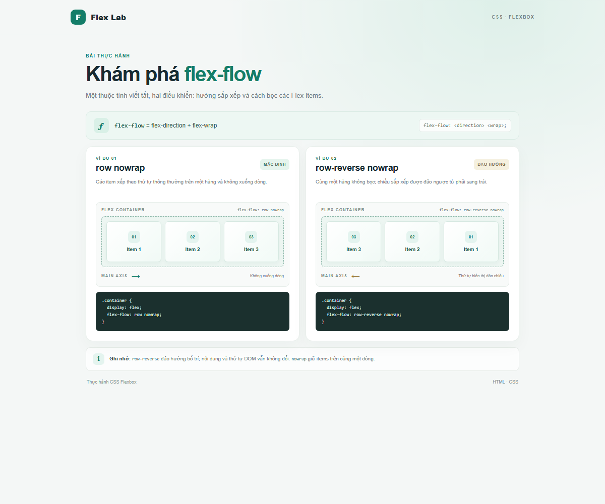

# CSS Flexbox: `flex-flow`

Bài thực hành minh họa hai ví dụ: `row nowrap` và `row-reverse nowrap`. Mỗi khung có thể cuộn ngang trên màn hình hẹp để thấy đủ ba Flex Items mà không làm tràn trang.

## Chạy bài

Mở `index.html` trong trình duyệt. Không cần cài đặt thư viện.

## Ảnh kết quả

